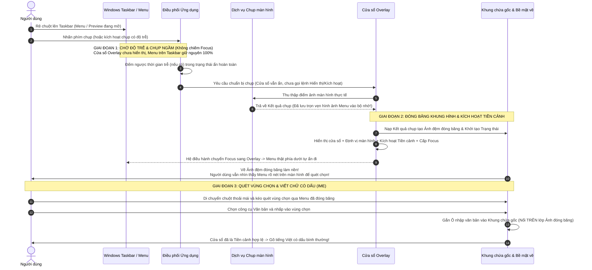

# 11.10 — Chụp Đóng Băng Khung Hình (Freeze-Frame Overlay) & Tương Thích Công Cụ Nhập Chữ (`TextTool` / IME)

> Tài liệu này thiết kế chi tiết kiến trúc vòng đời thu thập khung hình, cơ chế hiển thị nền đóng băng (Freeze-Frame) trên cửa sổ Overlay và sự phối hợp phân lớp để bảo toàn tuyệt đối khả năng nhập văn bản trực tiếp có dấu (IME) trên vùng chụp của F-Shot.
> **Nguyên tắc tài liệu:** Mô tả thuần túy bằng ngôn ngữ thiết kế kiến trúc, quy trình nghiệp vụ, cấu trúc phân lớp, luồng sự kiện và sơ đồ tương tác — **không sử dụng mã nguồn (code)**.

- **Mã tài liệu:** `11_10_FreezeFrameAndTextOverlay.md`
- **Thư mục:** `docs/2.Design/11_UI_Avalonia/`
- **Tài liệu liên quan:**
  - [11_03_OverlayWindow.md](file:///d:/Kojin/FShot/docs/2.Design/11_UI_Avalonia/11_03_OverlayWindow.md)
  - [11_09_OverlayStateIntegration.md](file:///d:/Kojin/FShot/docs/2.Design/11_UI_Avalonia/11_09_OverlayStateIntegration.md)
- **Yêu cầu kỹ thuật liên quan:** `FR-CAP-01`, `FR-CAP-02`, `FR-SEL-01`, `FR-ANN-08` (Công cụ Văn bản), `FR-ANN-21` (Nhập văn bản nhiều dòng & Bộ gõ IME).

---

## 1. Bối cảnh & Mô tả vấn đề

### 1.1. Hiện tượng lỗi thực tế khi chụp các thành phần giao diện tạm thời

Khi người dùng di chuyển chuột lên thanh tác vụ của hệ điều hành (Windows Taskbar) để xem hình thu nhỏ cửa sổ (thumbnail preview), danh sách nhảy (Jump List), khay hệ thống mở rộng, hoặc khi đang mở một menu ngữ cảnh (Context Menu / Popup Menu) trên ứng dụng bất kỳ rồi nhấn phím chụp màn hình:

1. Ngay tại thời điểm kích hoạt chế độ chụp, hoặc ngay khi người dùng vừa nhích con trỏ chuột ra khỏi vị trí thanh tác vụ để bắt đầu kéo quét vùng chọn, **menu hoặc cửa sổ thu nhỏ đó lập tức tự động ẩn mất**.
2. Kết quả là người dùng không thể khoanh vùng và chụp được các đối tượng giao diện có tính chất tạm thời (transient UI) đúng tại khoảnh khắc bấm nút chụp.

### 1.2. Nguyên lý hoạt động chuẩn của Flameshot

Trong Flameshot và các công cụ chụp màn hình chuyên nghiệp:

- Ngay khoảnh khắc người dùng phát lệnh chụp (hoặc ngay khi kết thúc thời gian đếm ngược độ trễ), hệ thống thực hiện **thu thập toàn bộ dữ liệu điểm ảnh của màn hình vào bộ nhớ đệm trước** khi bất kỳ cửa sổ giao diện nào của ứng dụng chụp xuất hiện trên màn hình.
- Sau khi bức ảnh tĩnh đã nằm an toàn trong bộ nhớ, ứng dụng mới hiển thị cửa sổ Overlay phủ kín màn hình và **dùng chính bức ảnh tĩnh vừa chụp làm lớp nền hiển thị (Freeze-Frame / Đóng băng khung hình)**.
- Nhờ cơ chế này, dù hệ điều hành Windows có tự động đóng menu thật ở bên dưới do phát hiện mất tiêu điểm (focus) hoặc do con trỏ chuột di chuyển ra chỗ khác, mắt người dùng vẫn nhìn thấy hình ảnh menu đã được "đóng băng" nguyên vẹn trên màn hình Overlay để thoải mái di chuyển chuột chọn màn hình và kéo quét vùng chọn.

---

## 2. Phân tích nguyên nhân gốc rễ trong luồng hoạt động hiện tại

Qua rà soát kiến trúc hiện tại của F-Shot, việc mất menu tạm thời trên thanh tác vụ xuất phát từ **hai nguyên nhân trực tiếp**:

### 2.1. Nguyên nhân thứ nhất: Cửa sổ Overlay xuất hiện và chiếm quyền điều khiển (Focus) trước khi chụp màn hình

Trong luồng điều phối mở Overlay hiện tại của tầng ứng dụng:

1. Ngay khi nhận lệnh chụp, hệ thống khởi tạo đối tượng cửa sổ Overlay và **phát lệnh hiển thị, lấy tiêu điểm bàn phím và kích hoạt cửa sổ lên tiền cảnh ngay lập tức**.
2. Chỉ sau khi cửa sổ đã hiển thị và chiếm quyền điều khiển của hệ điều hành, tiến trình bất đồng bộ bên dưới mới bắt đầu đếm ngược thời gian trễ (nếu có) và gọi dịch vụ chụp màn hình.
3. **Hệ quả:** Ngay khoảnh khắc cửa sổ Overlay được kích hoạt ở bước đầu tiên, hệ điều hành Windows lập tức gửi thông báo mất tiêu điểm tới thanh tác vụ hoặc ứng dụng đang mở menu. Toàn bộ menu tạm thời bị đóng sập **trước cả khi** dịch vụ chụp màn hình kịp ghi nhận khung hình.

### 2.2. Nguyên nhân thứ hai: Cửa sổ Overlay đang dùng nền trong suốt xuyên thấu thay vì hiển thị ảnh đóng băng

Trong quy trình kết xuất đồ họa hiện tại của bề mặt vẽ Overlay:

1. Dù kết quả chụp màn hình đã được chuyển đổi thành ảnh điểm (bitmap) lưu trong bộ nhớ đệm để phục vụ khâu xuất file cuối cùng, quy trình vẽ lại chủ đích **bỏ qua không vẽ bức ảnh này lên màn hình** mà để cửa sổ hoàn toàn trong suốt nhằm nhìn xuyên thấu xuống màn hình máy tính thật (live desktop) ở phía dưới.
2. **Hệ quả:** Vì mắt người dùng đang nhìn trực tiếp vào màn hình thật bên dưới lớp kính trong suốt:
   - Ngay khi cửa sổ Overlay hiện lên hoặc khi người dùng rê chuột rời khỏi thanh tác vụ để kéo vùng chọn, thanh tác vụ trên màn hình thật phát hiện chuột đã rời đi nên lập tức tắt menu thu nhỏ.
   - Dù trong bộ nhớ đệm có thể đã lưu được hình ảnh menu (nếu chụp trước), trên màn hình hiển thị thực tế menu đó vẫn biến mất, khiến người dùng không thể nhìn thấy mục tiêu để khoanh vùng chọn.

---

## 3. Điều tra chuyên sâu: Các cơ chế trên Overlay đang phục vụ Công cụ Nhập chữ & Bộ gõ Tiếng Việt

Trước khi thay đổi cơ chế hiển thị của cửa sổ Overlay sang chế độ Đóng băng khung hình, cần nắm rõ toàn bộ các thiết kế đặc thù đã được xây dựng trên Overlay để giải quyết bài toán **viết chữ trực tiếp lên vùng chụp** (bao gồm cả việc gõ tiếng Việt có dấu qua bộ gõ IME như UniKey / EVKey / Windows IME).

Qua điều tra, có **5 cơ chế cốt lõi** đang đảm bảo cho công cụ nhập văn bản hoạt động:

### 3.1. Kiến trúc phân lớp cây giao diện (Container gốc bọc bề mặt vẽ và Ô nhập chữ)

- Bản thân bề mặt vẽ tùy chỉnh (Custom Render Control) đảm nhận việc vẽ lớp phủ tối, khung vùng chọn, thanh công cụ và các nét vẽ chú thích là một thành phần đồ họa thuần túy, **không phải là một khung chứa (Panel)** nên không thể trực tiếp chứa các điều khiển giao diện con.
- Để hiển thị được một **Ô nhập văn bản chuẩn của Avalonia** khi người dùng chọn công cụ viết chữ, cửa sổ Overlay sử dụng một **Khung chứa gốc dạng Canvas trong suốt** phủ toàn bộ cửa sổ.
- Bên trong Khung chứa gốc này:
  - **Lớp dưới (Phần tử đầu tiên):** Là bề mặt vẽ tùy chỉnh của Overlay.
  - **Lớp trên (Phần tử anh em được thêm động):** Khi người dùng nhấp chuột vào vùng chọn để viết chữ, một điều khiển Ô nhập văn bản tạm thời được khởi tạo và gắn vào Khung chứa gốc ở vị trí sau bề mặt vẽ. Nhờ thứ tự xếp lớp (Z-order), Ô nhập văn bản luôn nổi lên trên bề mặt vẽ tại đúng tọa độ con trỏ chuột vừa nhấp.

### 3.2. Hai lớp phủ bắt sự kiện chuột (Hit-Testing) trên nền cửa sổ trong suốt

- Trong cơ chế của Avalonia trên nền tảng Windows, nếu một khu vực trên cửa sổ không có bất kỳ điểm ảnh nào được tô vẽ (hoặc hoàn toàn trong suốt), hệ thống kiểm tra va chạm (Hit-Testing) sẽ coi khu vực đó là "rỗng" và cho phép cú nhấp chuột **xuyên thủng qua cửa sổ** rơi xuống ứng dụng nằm phía sau trên màn hình nền.
- Đặc biệt, khi người dùng đã tạo vùng chọn, lớp làm tối màn hình chỉ tô 4 dải chữ nhật bao quanh phía ngoài và chừa trống hoàn toàn khu vực bên trong vùng chọn.
- Để ngăn chặn hiện tượng nhấp chuột bị lọt xuống màn hình nền khi người dùng nhấn vào bên trong vùng chọn để mở Ô nhập văn bản (hoặc khi nhấp ra ngoài Ô nhập văn bản để hoàn tất câu chữ), bề mặt vẽ hiện đang duy trì **hai lớp tô phủ vô hình** (có độ đục bằng không nhưng vẫn được ghi nhận là hình khối có màu):
  1. **Lớp phủ bắt chuột toàn cục:** Phủ kín toàn bộ diện tích bề mặt vẽ ngay đầu chu kỳ kết xuất.
  2. **Lớp phủ bắt chuột nội vùng:** Phủ kín diện tích bên trong khung vùng chọn.
- Nhờ hai lớp phủ này, mọi thao tác nhấp chuột để đặt Ô nhập chữ, kéo vẽ chú thích, hoặc nhấp ra ngoài để chốt văn bản đều được bề mặt vẽ bắt giữ trọn vẹn 100%.

### 3.3. Điều kiện kích hoạt Cửa sổ Tiền cảnh (Foreground Window) cho Bộ gõ Tiếng Việt (IME)

- Trên hệ điều hành Windows, trình quản lý bộ gõ tiếng Việt (Input Method Editor) chỉ gắn kết và gửi chuỗi ký tự tổ hợp có dấu vào một Ô nhập văn bản khi cửa sổ chứa nó thỏa mãn đầy đủ các điều kiện của một cửa sổ tiền cảnh hợp lệ:
  1. Cửa sổ phải bật cờ **hiển thị trên thanh tác vụ** và cờ **luôn nổi trên cùng**.
  2. Cửa sổ phải được hệ điều hành **kích hoạt làm cửa sổ tiền cảnh đang hoạt động** và được cấp tiêu điểm bàn phím.
  3. Khi Ô nhập văn bản được gắn vào Khung chứa gốc, hệ thống phải thực hiện **cấp tiêu điểm kép**: vừa yêu cầu tiêu điểm ngay lập tức, vừa xếp lịch yêu cầu lại tiêu điểm trên luồng giao diện ngay sau khi chu kỳ bố cục hoàn tất để trình quản lý bộ gõ của hệ điều hành kịp thời nhận diện.

### 3.4. Cơ chế nhường quyền bàn phím khi Ô nhập văn bản đang mở

- Ở trạng thái bình thường, bề mặt vẽ lắng nghe các phím đơn trên bàn phím vật lý (như các chữ cái tắt để chuyển nhanh sang bút vẽ, đường thẳng, mũi tên, hình chữ nhật, đánh dấu, làm mờ, hoặc các phím số để đổi kích thước nét vẽ).
- Tuy nhiên, ngay khi phát hiện **Ô nhập văn bản đang tồn tại trên màn hình**, bộ xử lý phím của bề mặt vẽ chủ động **ngắt toàn bộ bảng phím tắt đơn**, nhường trọn vẹn luồng sự kiện bàn phím và bộ gõ cho Ô nhập văn bản xử lý.
- Chỉ giữ lại hai ngoại lệ điều khiển:
  - Phím thoát (`Escape`): Hủy bỏ hoặc đóng Ô nhập văn bản.
  - Tổ hợp phím hoàn tất (`Ctrl + Enter`): Chốt nội dung văn bản ngay lập tức để chuyển thành đối tượng chú thích cố định, trong khi phím `Enter` đơn được giữ nguyên để xuống dòng mới.

### 3.5. Cơ chế đồng bộ tọa độ khi chuyển đổi từ Ô nhập văn bản sang Chú thích cố định

- Trong lúc người dùng đang gõ, văn bản hiển thị bên trong điều khiển Ô nhập văn bản đặt trên Khung chứa gốc theo tọa độ cục bộ của cửa sổ.
- Ngay khi người dùng nhấn `Ctrl + Enter` hoặc nhấp chuột ra ngoài (làm Ô nhập văn bản mất tiêu điểm), hệ thống thu hồi nội dung chữ, xóa bỏ điều khiển Ô nhập văn bản khỏi Khung chứa gốc, và chuyển nội dung đó thành một đối tượng chú thích văn bản cố định được vẽ trực tiếp lên bề mặt vẽ (cũng như vẽ lên bức ảnh xuất ra cuối cùng).

---

## 4. Giải pháp Thiết kế: "Chụp Ngầm Trước — Đóng Băng Sau — Bảo Toàn Tuyệt Đối Tiêu Điểm Nhập Chữ"

### 4.1. Giải quyết bài toán mâu thuẫn về Tiêu điểm (Focus)

Thoạt nhìn, có một sự đối lập giữa hai yêu cầu:

- **Yêu cầu giữ menu Taskbar:** Tuyệt đối **không được** hiển thị hay kích hoạt cửa sổ Overlay trước khi chụp vì sẽ làm mất tiêu điểm của Taskbar khiến menu biến mất.
- **Yêu cầu gõ chữ tiếng Việt (IME):** Bắt buộc **phải** hiển thị, kích hoạt làm cửa sổ tiền cảnh và cấp tiêu điểm cho cửa sổ Overlay thì bộ gõ mới hoạt động trong Ô nhập chữ.

Giải pháp thiết kế hóa giải triệt để sự đối lập này bằng cách **phân tách theo trục thời gian (Timeline Separation)** kết hợp với **vẽ nền đóng băng (Freeze-Frame)**:

1. **Giai đoạn trước và trong khi chụp (Trạng thái Ngầm — Không can thiệp Focus):** Cửa sổ Overlay chưa được hiển thị và chưa được kích hoạt. Màn hình và tiêu điểm của hệ điều hành giữ nguyên 100% ở thanh tác vụ hoặc menu đang mở cho đến khi dịch vụ chụp sao chép xong toàn bộ điểm ảnh vào bộ nhớ.
2. **Giai đoạn sau khi đã có ảnh trong bộ nhớ (Trạng thái Đóng băng & Kích hoạt đầy đủ):** Ngay khi bức ảnh chụp (đã chứa hình ảnh menu) nằm trong bộ nhớ đệm, hệ thống mới nạp ảnh vào bề mặt vẽ, hiển thị cửa sổ, kích hoạt cửa sổ lên tiền cảnh và lấy tiêu điểm bàn phím. Lúc này, dù menu thật ở dưới màn hình nền có tự đóng lại do mất tiêu điểm, người dùng vẫn nhìn thấy hình ảnh menu đã được vẽ cố định trên lớp nền của cửa sổ Overlay, đồng thời cửa sổ đã có đầy đủ tiêu điểm tiền cảnh để sẵn sàng cho công cụ viết chữ!

### 4.2. Sơ đồ tuần tự luồng hoạt động mới



---

## 5. Thiết kế chi tiết các thay đổi trong Kiến trúc

### 5.1. Thiết kế lại Quy trình Kích hoạt Cửa sổ trong Tầng Điều phối Ứng dụng

Quy trình điều phối khi nhận yêu cầu mở Overlay chụp màn hình được chuẩn hóa lại theo đúng thứ tự tuần tự sau:

1. **Kiểm tra phiên chụp hiện hành:** Nếu trên màn hình đã có sẵn một cửa sổ Overlay đang hiển thị, hệ thống chỉ đưa cửa sổ đó lên tiền cảnh và cấp lại tiêu điểm mà không tạo phiên mới.
2. **Khởi tạo ngầm đối tượng cửa sổ:** Tạo mới đối tượng cửa sổ Overlay trong bộ nhớ, truyền bản chụp cấu hình hiện tại và giới hạn phạm vi màn hình cần chụp (toàn bộ màn hình ảo hoặc một màn hình cụ thể), đồng thời đăng ký sự kiện dọn dẹp khi cửa sổ đóng.
3. **Loại bỏ hoàn toàn việc hiển thị sớm:** Tại bước khởi tạo này, tầng điều phối **tuyệt đối không** gọi lệnh hiển thị cửa sổ, **không** yêu cầu tiêu điểm và **không** kích hoạt cửa sổ.
4. **Thực thi tiến trình chụp ngầm:**
   - Nếu yêu cầu chụp có cấu hình độ trễ (ví dụ chờ 3 giây hoặc 5 giây), hệ thống thực hiện chờ hết khoảng thời gian này trong khi chưa có bất kỳ cửa sổ nào xuất hiện trên màn hình. Người dùng có toàn quyền mở các menu chuột phải, menu tầng hoặc rê chuột vào thanh tác vụ trong thời gian này.
   - Ngay khi hết thời gian trễ, hệ thống gọi quy trình chụp và hiển thị của cửa sổ Overlay.
5. **Hiển thị và kích hoạt sau khi có ảnh:** Chỉ bên trong quy trình của cửa sổ Overlay, **sau khi** dịch vụ chụp màn hình đã trả về dữ liệu điểm ảnh thành công và nạp xong vào bề mặt vẽ, cửa sổ mới thực hiện:
   - Đặt kích thước khớp với vùng màn hình mục tiêu.
   - Phát lệnh hiển thị cửa sổ lên màn hình.
   - Dịch chuyển cửa sổ về đúng tọa độ góc trên bên trái của vùng màn hình mục tiêu.
   - Kích hoạt cửa sổ lên làm cửa sổ tiền cảnh của hệ điều hành và cấp tiêu điểm bàn phím để sẵn sàng nhận phím tắt cũng như phục vụ bộ gõ IME.

> [!IMPORTANT]
> Với trình tự mới này, trong suốt khoảng thời gian từ lúc nhấn phím chụp cho tới khi toàn bộ điểm ảnh màn hình được sao chép xong vào bộ nhớ RAM, hệ điều hành không nhận được bất kỳ sự kiện thay đổi cửa sổ tiền cảnh nào. Mọi menu tạm thời trên Taskbar hoặc ứng dụng đang mở đều được chụp lại nguyên trạng 100%.

---

### 5.2. Thiết kế lại Chu kỳ Kết xuất Đồ họa của Bề mặt vẽ (Vẽ nền Freeze-Frame)

Trong chu kỳ kết xuất đồ họa của bề mặt vẽ trên cửa sổ Overlay, thứ tự xếp chồng các lớp vẽ từ dưới lên trên (Painter's Algorithm) được thiết kế lại như sau:

```
┌─────────────────────────────────────────────────────────────────────────┐
│ TẦNG 2 (Trong Khung chứa gốc): Điều khiển Ô nhập văn bản (TextBox)      │
│   • Chỉ xuất hiện khi người dùng đang gõ chữ tại vị trí nhấp chuột      │
│   • Nằm tách biệt và nổi hoàn toàn lên trên Bề mặt vẽ                   │
├─────────────────────────────────────────────────────────────────────────┤
│ TẦNG 1 (Trong Khung chứa gốc): Bề mặt vẽ Overlay (CaptureCanvas)        │
│   ├── Lớp 1.7: Chỉ báo kích thước nổi & Khung chọn đối tượng chú thích  │
│   ├── Lớp 1.6: Thanh công cụ nổi (Toolbar)                              │
│   ├── Lớp 1.5: Các nét vẽ chú thích đã chốt & Nét vẽ đang xem trước     │
│   ├── Lớp 1.4: Huy hiệu thông số hình học (W × H + X + Y)               │
│   ├── Lớp 1.3: Đường viền vùng chọn, 8 điểm neo & Lớp phủ bắt chuột nội │
│   ├── Lớp 1.2: Lớp phủ làm tối (Dimming) 4 dải bên ngoài vùng chọn      │
│   ├── Lớp 1.1: ★ ẢNH CHỤP ĐÓNG BĂNG (Freeze-Frame Cached Bitmap) ★      │
│   └── Lớp 1.0: Lớp phủ bắt chuột toàn cục (Hit-Test nền)                │
└─────────────────────────────────────────────────────────────────────────┘
```

Chi tiết thay đổi tại **Lớp 1.1 (Ảnh chụp đóng băng)**:

- Khi bề mặt vẽ đã có sẵn đối tượng ảnh điểm trong bộ nhớ đệm (được tạo từ kết quả chụp màn hình):
  - Thay vì bỏ trống để nhìn xuyên qua cửa sổ như trước, bề mặt vẽ thực hiện **vẽ toàn bộ bức ảnh điểm này trải khớp từ góc trên-trái đến hết chiều rộng và chiều cao của bề mặt vẽ**.
- Khi Lớp 1.2 (Lớp phủ làm tối) được vẽ đè lên trên:
  - Khu vực bên ngoài vùng chọn sẽ được phủ một lớp màu tối bán trong suốt làm dịu độ sáng của bức ảnh đóng băng.
  - Khu vực bên trong vùng chọn được để trống (không tô lớp làm tối), nhờ đó **phần ảnh đóng băng nằm trong vùng chọn sẽ lộ ra với độ sáng và độ sắc nét nguyên bản 100%**.
- Người dùng nhìn vào màn hình sẽ có cảm giác hệt như đang thao tác trực tiếp trên màn hình thật, nhưng thực chất toàn bộ hình ảnh (bao gồm các menu trên Taskbar) đã được giữ cố định trên Lớp 1.1.

---

### 5.3. Thiết kế Đồng bộ Hệ tọa độ & Tỉ lệ Điểm ảnh (DPI) trên Nền Đóng băng

Để bức ảnh đóng băng hiển thị trên màn hình khớp tuyệt đối từng điểm ảnh với màn hình thật bên dưới (không bị giật hình khi Overlay hiện lên) và khớp với ảnh cắt ra khi xuất file:

1. **Ánh xạ khung nguồn và khung đích:**
   - Khung nguồn lấy trọn vẹn kích thước điểm ảnh thực tế của bức ảnh trong bộ nhớ đệm (từ tọa độ không đến chiều rộng và chiều cao điểm ảnh).
   - Khung đích trải khớp toàn bộ khung kích thước hiển thị của bề mặt vẽ trên cửa sổ Overlay.
2. **Đồng nhất giữa vùng hiển thị và vùng cắt ảnh xuất ra:**
   - Khi người dùng kéo khung vùng chọn bao quanh chiếc menu trên nền ảnh đóng băng, tọa độ vùng chọn được chuyển đổi sang tọa độ điểm ảnh vật lý để cắt ra bức ảnh cuối cùng (khi Sao chép, Lưu tệp hoặc Ghim ảnh).
   - Do cả lớp ảnh nền đóng băng, lớp làm tối và khung vùng chọn đều dùng chung một gốc tọa độ của vùng chụp màn hình, hình ảnh nằm bên trong khung chọn trên màn hình sẽ trùng khớp 100% với bức ảnh được cắt ra khi xuất.

---

## 6. Kiểm chứng Tương thích: Bảo toàn 100% Tính năng Viết chữ (`TextTool` & IME)

Bảng phân tích tác động dưới đây chứng minh việc bổ sung cơ chế Chụp ngầm và Vẽ nền đóng băng hoàn toàn tương thích và không gây ra bất kỳ xung đột nào với các sửa đổi trước đây dành cho công cụ viết chữ:

| Thành phần của Công cụ Viết chữ                                                          | Cơ chế hoạt động đã thiết lập                                                                                                                                       | Tác động khi áp dụng Thiết kế Đóng băng Khung hình                                                                                                                                                                                                                                                                                                                                                                       | Đánh giá tương thích |
| :---------------------------------------------------------------------------------------------- | :--------------------------------------------------------------------------------------------------------------------------------------------------------------------------- | :---------------------------------------------------------------------------------------------------------------------------------------------------------------------------------------------------------------------------------------------------------------------------------------------------------------------------------------------------------------------------------------------------------------------------------- | :------------------------- |
| **1. Khả năng hiển thị Ô nhập chữ nổi trên vùng chụp**                         | Ô nhập chữ được gắn vào Khung chứa gốc với tư cách là phần tử anh em nằm sau Bề mặt vẽ.                                                                  | Bức ảnh đóng băng được vẽ **bên trong** chu kỳ kết xuất của Bề mặt vẽ (Tầng 1), trong khi Ô nhập chữ nằm ở Tầng 2 cao hơn trong cây giao diện. Ảnh đóng băng đóng vai trò làm phông nền phía dưới và **không bao giờ đè lên hay che khuất Ô nhập chữ**.                                                                                                               | **Bảo toàn 100%**  |
| **2. Nhấp chuột vào vùng chọn để đặt chữ & Nhấp ra ngoài để chốt chữ**    | Duy trì hai lớp phủ bắt chuột vô hình trên toàn màn hình và bên trong khung vùng chọn để ngăn chuột lọt qua cửa sổ.                                    | Việc vẽ thêm bức ảnh đóng băng lấp đầy bề mặt vẽ càng giúp bề mặt vẽ có dữ liệu điểm ảnh đặc, kết hợp với việc giữ nguyên hai lớp phủ bắt chuột đảm bảo mọi cú nhấp chuột mở và đóng Ô nhập chữ hoạt động chính xác tuyệt đối.                                                                                                                                           | **Bảo toàn 100%**  |
| **3. Gõ Tiếng Việt có dấu (Bộ gõ IME) & Con trỏ nhấp nháy trong Ô nhập chữ** | Đòi hỏi cửa sổ phải hiển thị trên thanh tác vụ, được kích hoạt làm cửa sổ tiền cảnh của hệ điều hành và cấp tiêu điểm kép cho Ô nhập chữ. | Thiết kế mới chỉ loại bỏ việc kích hoạt cửa sổ **trước lúc chụp** (kéo dài vài chục mili-giây). Ngay sau khi chụp xong, cửa sổ vẫn được hiển thị, đưa lên tiền cảnh và cấp tiêu điểm đầy đủ như cũ. Khi người dùng chọn công cụ chữ và nhấp chuột, cửa sổ đã là cửa sổ tiền cảnh hợp lệ của Windows nên bộ gõ tiếng Việt hoạt động bình thường. | **Bảo toàn 100%**  |
| **4. Chặn phím tắt công cụ khi đang gõ văn bản**                                 | Khi Ô nhập chữ đang mở, bộ xử lý phím của bề mặt vẽ bỏ qua toàn bộ phím tắt đơn chuyển công cụ, chỉ bắt phím thoát và tổ hợp phím chốt chữ. | Toàn bộ quy tắc xử lý sự kiện bàn phím, sự kiện nhận chuỗi ký tự và vòng đời tạo/hủy Ô nhập chữ được giữ nguyên, không có bất kỳ thay đổi nào.                                                                                                                                                                                                                                                  | **Bảo toàn 100%**  |
| **5. Vị trí chữ sau khi chốt (Commit) trên vùng chọn**                             | Khi chốt chữ, nội dung từ Ô nhập chữ được chuyển thành đối tượng chú thích văn bản vẽ tại đúng tọa độ đã nhấp.                                 | Đối tượng chú thích văn bản nằm ở Lớp 1.5 (vẽ đè lên trên Lớp 1.1 là Ảnh đóng băng), nên ngay khi Ô nhập chữ đóng lại, dòng chữ đã chốt hiển thị rõ nét ngay trên nền ảnh đóng băng và được xuất ra ảnh cuối cùng.                                                                                                                                                              | **Bảo toàn 100%**  |

---

## 7. Tóm tắt Quy trình Triển khai (Khi chuyển sang giai đoạn thực thi)

Khi thực hiện điều chỉnh hệ thống theo tài liệu thiết kế này, phạm vi thay đổi được giới hạn chặt chẽ ở **2 điểm duy nhất**, không chạm vào cấu trúc của công cụ nhập văn bản:

1. **Tại luồng điều phối mở Overlay của ứng dụng:**
   - Gỡ bỏ thao tác hiển thị, lấy tiêu điểm và kích hoạt cửa sổ bị gọi sớm trước khi tiến trình chụp màn hình bắt đầu.
   - Đảm bảo tiến trình chờ độ trễ (nếu có) và tiến trình thu thập ảnh chụp màn hình diễn ra hoàn toàn ngầm; chỉ hiển thị và kích hoạt cửa sổ sau khi đã thu nhận xong dữ liệu ảnh chụp.
2. **Tại quy trình kết xuất của bề mặt vẽ Overlay:**
   - Kích hoạt việc vẽ bức ảnh chụp trong bộ nhớ đệm phủ kín diện tích bề mặt vẽ ngay ở lớp dưới cùng (trước khi vẽ lớp làm tối, khung vùng chọn, các chú thích và thanh công cụ).
   - Giữ nguyên toàn bộ cấu trúc Khung chứa gốc, hai lớp phủ bắt sự kiện chuột, cấu hình cửa sổ tiền cảnh và toàn bộ quy trình xử lý Ô nhập văn bản kèm bộ gõ IME.

---

## 8. Kịch bản Kiểm thử Nghiệm thu

### Kịch bản 1: Chụp Menu thu nhỏ / Danh sách mở rộng trên Thanh tác vụ (Taskbar)

- **Thao tác:** Di chuyển chuột lên một biểu tượng ứng dụng đang mở trên thanh tác vụ Windows để làm xuất hiện hình thu nhỏ xem trước (hoặc nhấp chuột phải lên biểu tượng trên thanh tác vụ để mở menu ngữ cảnh), sau đó nhấn phím chụp màn hình.
- **Kết quả kỳ vọng:**
  - Màn hình lập tức chuyển sang trạng thái đóng băng với hình ảnh menu hoặc hình thu nhỏ trên thanh tác vụ vẫn hiển thị nguyên vẹn.
  - Khi người dùng di chuyển chuột ra vị trí khác trên màn hình và nhấn giữ chuột kéo vùng chọn ngang qua khu vực menu đó, hình ảnh menu trên màn hình tuyệt đối không bị biến mất.
  - Khi thực hiện Sao chép hoặc Lưu ảnh, bức ảnh thu được chứa đầy đủ hình ảnh của menu trên thanh tác vụ.

### Kịch bản 2: Chụp Menu ngữ cảnh với chế độ Hẹn giờ trễ (Delayed Capture)

- **Thao tác:** Mở trình phóng nhanh (Launcher), chọn chế độ chụp vùng chọn tương tác với độ trễ 3 giây. Trong 3 giây đếm ngược, mở một menu tầng (Submenu) trên một phần mềm bất kỳ và giữ nguyên cho đến khi hết 3 giây.
- **Kết quả kỳ vọng:**
  - Trong suốt 3 giây đếm ngược, ứng dụng không làm xuất hiện cửa sổ chiếm tiêu điểm khiến menu bị đóng.
  - Đúng thời điểm kết thúc 3 giây, khung hình đóng băng lại giữ nguyên toàn bộ menu tầng đang mở để người dùng khoanh vùng chọn.

### Kịch bản 3: Kiểm thử hồi quy Công cụ Nhập chữ & Bộ gõ Tiếng Việt trên nền Đóng băng

- **Thao tác:**
  1. Sau khi đã kéo quét vùng chọn trên màn hình đóng băng, chọn công cụ Văn bản từ thanh công cụ (hoặc nhấn phím tắt chọn công cụ chữ).
  2. Nhấp chuột trái vào bên trong vùng chọn đang hiển thị ảnh đóng băng.
  3. Bật bộ gõ tiếng Việt, gõ một câu tiếng Việt có đầy đủ dấu thanh và dấu mũ (bao gồm các chữ cái trùng với phím tắt công cụ), nhấn phím xuống dòng để gõ dòng thứ hai.
  4. Nhấn tổ hợp phím hoàn tất hoặc nhấp chuột ra ngoài Ô nhập chữ để chốt văn bản, sau đó xuất ảnh.
- **Kết quả kỳ vọng:**
  - Ô nhập chữ xuất hiện nổi rõ ràng phía trên lớp ảnh đóng băng, con trỏ văn bản nhấp nháy sẵn sàng ngay lập tức.
  - Quá trình gõ tiếng Việt diễn ra mượt mà, không bị bất kỳ phím tắt đơn nào của bề mặt vẽ cướp phím làm nhảy sang công cụ khác.
  - Sau khi chốt chữ, văn bản hiển thị sắc nét đúng vị trí trên nền ảnh đóng băng và có mặt đầy đủ trong bức ảnh xuất ra.
