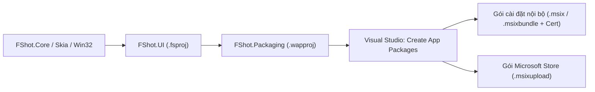

# F-Shot Progress — Phase 3: Quy trình Đóng gói MSIX & Phát hành Windows Store (Visual Studio Create App Packages)

- **Target:** Phase 3 (Packaging & Store Release)
- **Trạng thái:** IN PROGRESS (đã có bản build tự chứa `dotnet publish` để cài thử; MSIX qua VS wizard chưa thực hiện)
- **Công cụ chính:** Visual Studio 2022 (`Project` → `Publish` → `Create App Packages...`) + Windows Application Packaging Project (`.wapproj`)
- **Tài liệu thiết kế liên quan:** [12_06_Icon_Asset_Production_Guide.md](file:///d:/Kojin/FShot/docs/2.Design/12_UIUX_Mock_Penpot/12_06_Icon_Asset_Production_Guide.md) (Phần 1: Tiêu chuẩn Icon Ứng dụng MSIX)

---

## 1. Tổng quan Kiến trúc Đóng gói MSIX cho F-Shot

Do `FShot.UI` là project F# (`.fsproj`) chạy trên `.NET 8.0 (net8.0-windows10.0.19041.0)`, cách chuẩn xác, ổn định và hỗ trợ trực tiếp menu **Publish → Create App Packages...** trên giao diện Visual Studio là sử dụng **Windows Application Packaging Project (`.wapproj`)** làm project đóng gói bao ngoài `FShot.UI`.

---

## 2. Quy trình Tổng quan 7 Bước (Step-by-Step Overview)

| Bước | Giai đoạn | Mục tiêu chính | Kết quả đầu ra (Deliverable) |
| :---: | :--- | :--- | :--- |
| **Step 1** | **Chuẩn bị Môi trường & Solution** | Cài workload MSIX trong Visual Studio và thêm project `FShot.Packaging (.wapproj)` vào `FShot.sln`. | Project `.wapproj` trỏ tới `FShot.UI`. |
| **Step 2** | **Cấu hình `FShot.UI.fsproj`** | Đồng bộ Target Framework, Runtime Identifier (`win-x64`, `win-arm64`) và thông tin Metadata xuất bản. | `FShot.UI` build sạch ở chế độ Release. |
| **Step 3** | **Tạo Bộ Visual Assets (Icons)** | Dùng **Asset Generator** trong Visual Studio sinh đủ các kích thước logo MSIX từ ảnh gốc `1024×1024 px`. | Thư mục `Images/` hoặc `Assets/` chứa đủ 5 tỷ lệ scale (100%–400%). |
| **Step 4** | **Cấu hình `Package.appxmanifest`** | Khai báo định danh ứng dụng, quyền `runFullTrust`, StartupTask (khởi động cùng Windows) và CLI Execution Alias (`fshot.exe`). | File `Package.appxmanifest` hoàn chỉnh. |
| **Step 5** | **Chạy Wizard `Create App Packages`** | Sử dụng giao diện Visual Studio để đóng gói ra bản Sideloading (cài thử trên máy) hoặc bản Microsoft Store. | File `.msix` / `.msixbundle` và `.msixupload`. |
| **Step 6** | **Cài đặt & Kiểm thử MSIX trên Windows** | Cài gói MSIX vừa xuất lên máy thật Windows 10/11, kiểm tra quyền chụp màn hình, phím `PrintScreen`, lưu file và gỡ cài đặt. | Bản cài MSIX chạy mượt như bản unpackaged. |
| **Step 7** | **Kiểm định WACK & Đưa lên Store** | Chạy công cụ **Windows App Certification Kit (WACK)** tự động cuối wizard và upload lên Partner Center. | Báo cáo WACK `PASSED` & gói sẵn sàng lên Store. |

---

## 3. Checklist Chi tiết Từng Bước (Actionable Progress)

### Step 1: Chuẩn bị Visual Studio & Tạo Packaging Project (`P3.M01`)
- [ ] **1.1. Kiểm tra Workload trong Visual Studio Installer:**
  - [ ] Mở *Visual Studio Installer* → *Modify* bản Visual Studio 2022 đang dùng.
  - [ ] Đảm bảo đã tích chọn **".NET Desktop Development"** và thành phần **"Windows Application Packaging Project"** (hoặc *Universal Windows Platform development* / *MSIX Packaging Tools*).
- [ ] **1.2. Thêm project đóng gói vào Solution `FShot.sln`:**
  - [ ] Mở `D:\Kojin\FShot\FShot.sln` trong Visual Studio.
  - [ ] Chuột phải vào Solution `FShot` → **Add** → **New Project...**.
  - [ ] Tìm và chọn mẫu **Windows Application Packaging Project** (biểu tượng hộp gói MSIX).
  - [ ] Đặt tên project: `FShot.Packaging`, lưu tại `src\FShot.Packaging\`.
  - [ ] Chọn Target Version: `Windows 11 / Windows 10, version 2004 (10.0; Build 19041)` trở lên; Minimum Version: `Windows 10, version 1809 (Build 17763)` hoặc `19041` (khớp với `FShot.UI.fsproj`).
- [ ] **1.3. Liên kết `FShot.UI` vào `FShot.Packaging`:**
  - [ ] Trong Solution Explorer, mở nhánh `FShot.Packaging` → chuột phải vào mục **Applications** → **Add Reference...**.
  - [ ] Tích chọn project **`FShot.UI`** → bấm **OK**.
  - [ ] Chuột phải vào `FShot.UI` bên trong mục *Applications* → xác nhận nó được đặt làm **Entry Point** (in đậm).

---

### Step 2: Chuẩn hóa Cấu hình Build trong `FShot.UI.fsproj` (`P3.M02`)
- [x] **2.1. Khai báo thông tin Assembly & Runtime cho MSIX:**
  - [x] Bổ sung vào [FShot.UI.fsproj](file:///d:/Kojin/FShot/src/FShot.UI/FShot.UI.fsproj) các thuộc tính phục vụ đóng gói:
    - [x] `RuntimeIdentifiers`: `win-x64;win-arm64` (để Visual Studio Create App Packages có thể tick chọn kiến trúc `x64` / `ARM64`).
    - [ ] `AssemblyName`: `FShot` (hoặc `fshot` để đồng bộ lệnh CLI) — **tạm hoãn** để tránh đổi tên exe `FShot.UI.exe` và phá vỡ Single-Instance/CLI.
    - [x] `Version`: `0.1.0` (khớp `--version` hiện tại; MSIX Version sẽ khai báo riêng trong `Package.appxmanifest` dạng `0.1.0.0`).
- [ ] **2.2. Kiểm tra tương thích đường dẫn lưu cấu hình khi chạy trong MSIX Container:**
  - [ ] Ứng dụng đóng gói MSIX chạy dưới quyền `runFullTrust`: biến môi trường `%APPDATA%` (`Environment.SpecialFolder.ApplicationData`) sẽ được Windows tự động ảo hóa an toàn hoặc ghi vào `AppData\Roaming\FShot\config.json` mà không cần sửa code.
  - [ ] Kiểm tra tính năng "Khởi động cùng Windows" (`StartupRegistration.fs`): trên bản MSIX Store, nên kết hợp hoặc chuyển sang `Windows.ApplicationModel.StartupTask` thay vì chỉ ghi thẳng vào Registry `HKCU\...\Run` (vì Store Certification ưu tiên `StartupTask` trong manifest).

---

### Step 3: Thiết lập Bộ Icon & Visual Assets chuẩn MSIX (`P3.M03`)
- [ ] **3.1. Chuẩn bị file icon gốc Kawaii F-Shot:**
  - [ ] Chuẩn bị 1 file ảnh gốc chất lượng cao `1024 × 1024 px` định dạng PNG nền trong suốt (theo chuẩn [12_06_Icon_Asset_Production_Guide.md](file:///d:/Kojin/FShot/docs/2.Design/12_UIUX_Mock_Penpot/12_06_Icon_Asset_Production_Guide.md)).
- [ ] **3.2. Tự động sinh toàn bộ kích thước icon bằng Visual Studio Asset Generator:**
  - [ ] Trong project `FShot.Packaging`, nhấp đúp mở file **`Package.appxmanifest`**.
  - [ ] Chuyển sang tab **Visual Assets**.
  - [ ] Tại mục **Source** của *Asset Generator*, bấm nút `...` chọn file PNG `1024×1024 px` gốc.
  - [ ] Tích chọn tất cả các nhóm bắt buộc cho Store:
    - [ ] `Square44x44Logo` (App List, Taskbar, Start Menu, Alt+Tab — các scale 100%, 125%, 150%, 200%, 400% + targetsize unplated).
    - [ ] `Square150x150Logo` (Medium Tile).
    - [ ] `Square71x71Logo` (Small Tile) & `Wide310x150Logo` / `Square310x310Logo` (tùy chọn).
    - [ ] `StoreLogo` (50×50 px hiển thị trên Microsoft Store).
    - [ ] `SplashScreen` (620×300 px).
  - [ ] Bấm nút **Generate** → Visual Studio tự động cắt, co giãn và điền toàn bộ đường dẫn ảnh vào `Package.appxmanifest`.

---

### Step 4: Cấu hình `Package.appxmanifest` cho Desktop Bridge & Store (`P3.M04`)
- [ ] **4.1. Tab Application:**
  - [ ] **Display name:** `F-Shot` (hoặc tên đã đăng ký trên Microsoft Partner Center).
  - [ ] **Description:** `Công cụ chụp ảnh màn hình và chú thích nhanh trên Windows`.
  - [ ] **Background color:** `transparent`.
- [ ] **4.2. Tab Packaging:**
  - [ ] **Package name:** Định danh duy nhất của gói (khi liên kết Store, Visual Studio sẽ tự đồng bộ mã này).
  - [ ] **Package display name:** `F-Shot`.
  - [ ] **Version:** Đặt dạng `1.0.0.0` (Lưu ý quy tắc Microsoft Store: số thứ 4 bắt buộc là `.0`, ví dụ `1.0.1.0`).
- [ ] **4.3. Tab Capabilities:**
  - [ ] Đảm bảo quyền **`runFullTrust`** (Full Trust Desktop App) được bật (mặc định có sẵn trong `.wapproj`).
  - [ ] **Lưu ý quan trọng khi lên Store:** Không tích thêm các quyền không cần thiết để quá trình Microsoft xét duyệt quyền `runFullTrust` diễn ra nhanh nhất.
- [ ] **4.4. Bổ sung App Execution Alias (`fshot.exe`) & StartupTask (View Code XML):**
  - [ ] Chuột phải vào `Package.appxmanifest` → **View Code** để thêm 2 tiện ích quan trọng cho người dùng Windows:
    1. **`uap5:AppExecutionAlias`**: Cho phép người dùng sau khi cài từ Store có thể mở PowerShell / CMD gõ thẳng lệnh `fshot gui`, `fshot full` từ bất kỳ đâu mà không cần tự cài biến môi trường `PATH`.
    2. **`desktop:StartupTask`**: Cho phép bật/tắt F-Shot khởi động cùng Windows trực tiếp trong *Windows Settings → Apps → Startup* và *Task Manager* chuẩn chính sách Store.

---

### Step 5: Build gói MSIX bằng Wizard `Create App Packages...` (`P3.M05`)
- [ ] **5.1. Mở trình tạo gói trong Visual Studio:**
  - [ ] Chuột phải vào project **`FShot.Packaging`** → chọn **Publish** → **Create App Packages...**.
- [ ] **5.2. Chọn chế độ phân phối (Select distribution method):**
  - [ ] **Trường hợp A — Tạo gói cài thử trên máy cá nhân (Sideloading):**
    - [ ] Chọn **Sideloading** → bấm *Next*.
    - [ ] Tại bước *Signing Method*: Chọn **Yes, select a certificate** → bấm **Create...** để tạo chứng chỉ tự ký (Self-signed test certificate `.pfx`) cho máy dev.
  - [ ] **Trường hợp B — Tạo gói đưa thẳng lên Microsoft Store:**
    - [ ] Chọn **Microsoft Store under a new app name** (hoặc chọn tên app đã đặt chỗ trên tài khoản Developer Partner Center) → đăng nhập tài khoản Microsoft Developer.
    - [ ] Visual Studio tự động cập nhật `Package.appxmanifest` (Publisher ID, Package Identity) khớp 100% với Store mà không cần tạo chứng chỉ thủ công.
- [ ] **5.3. Chọn cấu hình Kiến trúc & Bundle (Select and configure packages):**
  - [ ] **Output location:** Mặc định `AppPackages\`.
  - [ ] **Generate app bundle:** Chọn **Always**.
  - [ ] Trong bảng Architecture:
    - [ ] Tích chọn **x64** → đổi Configuration sang **`Release (x64)`**.
    - [ ] *(Tùy chọn)* Tích chọn **ARM64** → đổi Configuration sang **`Release (ARM64)`**.
  - [ ] Bấm nút **Create** và chờ Visual Studio biên dịch toàn bộ solution + đóng gói.

---

### Step 6: Cài đặt & Kiểm thử gói MSIX trên Windows (`P3.M06`)
- [ ] **6.1. Cài đặt gói `.msix` / `.msixbundle` trên máy Windows:**
  - [ ] Mở thư mục kết quả `src\FShot.Packaging\AppPackages\FShot.Packaging_1.0.x.0_Test\`.
  - [ ] *(Nếu là bản Sideloading lần đầu)*: Cài chứng chỉ `.cer` vào `Local Machine` → `Trusted People` (hoặc chạy script `Install.ps1` đi kèm bằng PowerShell Admin).
  - [ ] Nhấp đúp trực tiếp vào file **`FShot.Packaging_1.0.x.0_x64.msix`** → giao diện **Windows App Installer** hiện lên → bấm **Install**.
- [ ] **6.2. Checklist kiểm thử sau khi cài đặt:**
  - [ ] Kiểm tra biểu tượng **F-Shot** xuất hiện sắc nét trong **Windows Start Menu** và danh sách *Installed Apps*.
  - [ ] Khởi chạy F-Shot từ Start Menu → xác nhận biểu tượng xuất hiện dưới khay hệ thống **System Tray**.
  - [ ] Nhấn phím **`PrintScreen`** → xác nhận overlay chụp màn hình mở lên tức thì, chụp đúng độ phân giải Mixed-DPI.
  - [ ] Thử vẽ chú thích, bấm **Copy (`Ctrl+C`)** và **Save (`Ctrl+S`)** → xác nhận thông báo hiện ra và file lưu thành công vào thư mục `Pictures\Screenshots`.
  - [ ] Mở cửa sổ **Settings**, đổi cấu hình và bấm Lưu → tắt app mở lại xác nhận cấu hình được giữ nguyên.
  - [ ] Mở PowerShell bất kỳ, gõ `fshot --help` hoặc `fshot gui` → xác nhận Execution Alias hoạt động.
  - [ ] Thử **Uninstall** F-Shot từ Start Menu → xác nhận ứng dụng được gỡ sạch sẽ không để lại rác hệ thống.

---

### Step 7: Chạy Kiểm định WACK & Đưa lên Microsoft Store (`P3.M07`)
- [ ] **7.1. Chạy Windows App Certification Kit (WACK):**
  - [ ] Ngay sau khi Visual Studio báo *Package Creation Completed*, bấm nút **Launch Windows App Certification Kit**.
  - [ ] Để WACK tự động khởi chạy và kiểm tra F-Shot (kiểm tra chữ ký số, manifest, hiệu năng khởi động, không crash, API hợp lệ).
  - [ ] Xác nhận kết quả cuối cùng đạt trạng thái **PASSED**.
- [ ] **7.2. Upload gói `.msixupload` lên Partner Center:**
  - [ ] Truy cập trang quản trị [Microsoft Partner Center](https://partner.microsoft.com/dashboard).
  - [ ] Vào mục **Packages** của bản phát hành mới → kéo thả file **`.msixupload`** (nằm ngoài thư mục `AppPackages\`) lên.
  - [ ] Điền mô tả Store Listing, ảnh chụp màn hình giới thiệu F-Shot, ghi chú quyền `runFullTrust` (lý do: ứng dụng chụp ảnh màn hình desktop cần dùng Win32 Global Hotkey và Windows Graphics Capture) rồi bấm **Submit to the Store**.

