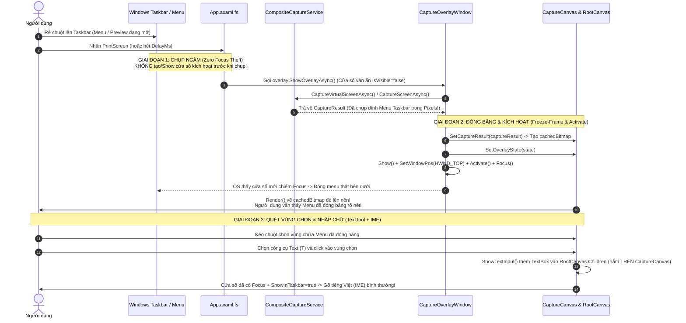

# Thiết kế Chụp Đóng Băng Màn Hình (Freeze-Frame Overlay) & Tương Thích Công Cụ Nhập Chữ (`TextTool` / IME)

- **Mã tài liệu:** `FreezeFrame_Capture_And_TextOverlay_Design.md`
- **Vị trí lưu tạm:** `docs/FreezeFrame_Capture_And_TextOverlay_Design.md`
- **Phạm vi ảnh hưởng:**
  - [App.axaml.fs](file:///d:/Kojin/FShot/src/FShot.UI/App.axaml.fs) (`showCaptureOverlay`)
  - [CaptureOverlayWindow.axaml](file:///d:/Kojin/FShot/src/FShot.UI/Windows/CaptureOverlayWindow.axaml) (`RootCanvas` & `CaptureCanvas`)
  - [CaptureOverlayWindow.axaml.fs](file:///d:/Kojin/FShot/src/FShot.UI/Windows/CaptureOverlayWindow.axaml.fs) (`ShowOverlayAsync`, `ConfigureOverlayWindow`)
  - [CaptureCanvas.axaml.fs](file:///d:/Kojin/FShot/src/FShot.UI/SkiaCanvas/CaptureCanvas.axaml.fs) (`Render`, `ShowTextInput`, `OnKeyDown`)
- **Yêu cầu liên quan:** `FR-CAP-01`, `FR-CAP-02`, `FR-SEL-01`, `FR-ANN-08` (`TextTool`), `FR-ANN-21` (Multiline & IME).

---

## 1. Bối cảnh & Mô tả vấn đề (Problem Statement)

### 1.1. Hiện tượng lỗi thực tế

Khi người dùng rê chuột vào **Windows Taskbar** (để xem thumbnail preview cửa sổ, jump list, system tray flyout) hoặc mở một **Context Menu / Popup Menu** tạm thời trên ứng dụng khác rồi bấm phím chụp màn hình (`PrintScreen`):

1. Ngay khoảnh khắc chuyển sang chế độ chụp hoặc khi người dùng vừa nhích chuột ra khỏi vị trí Taskbar để bắt đầu quét vùng chọn (`Selecting`), **menu/popup trên Taskbar lập tức biến mất**.
2. Kết quả là người dùng không thể chụp được các thành phần giao diện tạm thời (transient UI / ephemeral popups) đúng tại thời điểm bấm chụp.

### 1.2. Tại sao Flameshot chụp được mà không mất menu?

Trong Flameshot (và các trình chụp ảnh màn hình chuẩn như ShareX / Snipaste):

- Ngay tại khoảnh khắc bấm `PrintScreen` (hoặc sau khi hết `DelayMs`), ứng dụng **chụp toàn bộ framebuffer màn hình vào RAM trước** khi bất kỳ cửa sổ GUI nào của ứng dụng xuất hiện hoặc chiếm quyền điều khiển.
- Sau khi đã có bức ảnh chụp tĩnh trong bộ nhớ, ứng dụng mới hiển thị cửa sổ `CaptureOverlayWindow` phủ toàn màn hình và **vẽ chính bức ảnh tĩnh vừa chụp (`cachedBitmap`) làm lớp nền của cửa sổ overlay** (cơ chế **Freeze-Frame / Đóng băng khung hình**).
- Lúc này, dù hệ điều hành Windows có tự động đóng menu thật ở bên dưới do mất focus hay do chuột di chuyển ra chỗ khác, trên màn hình người dùng vẫn nhìn thấy hình ảnh menu đã được "đóng băng" trên lớp vẽ của `CaptureCanvas` để thoải mái rê chuột chọn màn hình và quét vùng chọn.

---

## 2. Phân tích nguyên nhân gốc rễ trong kiến trúc hiện tại

Qua điều tra mã nguồn hiện tại của F-Shot, có **2 nguyên nhân trực tiếp** khiến menu trên Taskbar bị ẩn mất:

### Nguyên nhân 1: Kích hoạt và chiếm Focus cửa sổ Overlay TRƯỚC KHI chụp màn hình

Tại [App.axaml.fs](file:///d:/Kojin/FShot/src/FShot.UI/App.axaml.fs#L185-L215) trong hàm `showCaptureOverlay`:

```fsharp
let overlay = CaptureOverlayWindow()
overlay.ConfigSnapshot <- App.ConfigSnapshot
overlay.CaptureBounds <- captureBounds
desktop.MainWindow <- overlay
currentOverlay <- Some overlay
...
// ❌ LỖI THỨ TỰ: Hiển thị và chiếm Focus hệ điều hành NGAY LẬP TỨC tại đây!
overlay.Show()
overlay.Focus() |> ignore
overlay.Activate() |> ignore

async {
    try
        if request.DelayMs > 0 then
            do! Async.Sleep request.DelayMs
        // Khi ShowOverlayAsync() chạy để chụp màn hình thì cửa sổ đã Show() và cướp Focus mất rồi!
        do! overlay.ShowOverlayAsync()
...
```

- Khi `overlay.Show()` và `overlay.Activate()` được gọi ở dòng 201–203, Windows lập tức gửi thông điệp `WM_ACTIVATE` / `WM_KILLFOCUS` tới Taskbar hoặc ứng dụng đang mở menu.
- Hệ quả là Windows đóng sập menu/flyout **trước cả khi** `request.DelayMs` kết thúc và **trước khi** `CompositeCaptureService` kịp chụp frame màn hình trong `ShowOverlayAsync()`.

### Nguyên nhân 2: Cửa sổ Overlay đang để "Trong suốt nhìn xuyên thấu" thay vì vẽ ảnh Freeze-Frame

Tại [CaptureCanvas.axaml.fs](file:///d:/Kojin/FShot/src/FShot.UI/SkiaCanvas/CaptureCanvas.axaml.fs#L1725-L1736) trong phương thức `override this.Render(context: DrawingContext)`:

```fsharp
// Flameshot-style: cửa sổ trong suốt, không vẽ screenshot stub đè lên desktop.
// Capture result vẫn được lưu để export pipeline sử dụng.
// Dimming và annotations được vẽ trên nền trong suốt.
match cachedBitmap with
| Some _ ->
    // ❌ Không vẽ screenshot lên overlay; desktop gốc hiển thị phía sau cửa sổ.
    ()
| None ->
    let brush = new SolidColorBrush(Avalonia.Media.Color.FromArgb(32uy, 128uy, 128uy, 128uy))
    context.FillRectangle(brush, this.Bounds)
```

- Dù `SetCaptureResult` đã tạo sẵn `cachedBitmap: WriteableBitmap option` (dòng 590), hàm `Render` lại cố tình bỏ qua (`()`) không vẽ `cachedBitmap` lên `DrawingContext` để nhìn xuyên qua lớp nền trong suốt xuống màn hình thật (live desktop) phía dưới.
- Vì người dùng đang nhìn vào **màn hình thật (live desktop)** chứ không phải ảnh chụp tĩnh:
  1. Khi cửa sổ Overlay hiện lên hoặc khi người dùng di chuyển con trỏ chuột khỏi vùng hover của Taskbar để kéo vùng chọn, Taskbar phát hiện chuột đã rời đi / mất focus nên ẩn preview menu ngay trên màn hình thật.
  2. Dù `captureResult` trong RAM có thể đã chụp được menu (nếu chụp trước khi `Show()`), người dùng trên màn hình vẫn thấy menu biến mất hoàn toàn và không biết vị trí của nó ở đâu để quét chuột chọn.

---

## 3. Điều tra chuyên sâu: Các thay đổi trên Overlay phục vụ Công cụ Nhập chữ (`TextTool` & IME)

Theo yêu cầu đặc biệt: *"Trước đây để viết chữ trên capture region, tôi đã có sửa gì vào overlay. Hãy chú ý điều tra cái đó."* — Dưới đây là toàn bộ kết quả điều tra các cơ chế đã được thiết kế trong `CaptureOverlayWindow` và `CaptureCanvas` để hỗ trợ nhập văn bản (`TextTool` / `Avalonia.Controls.TextBox` / bộ gõ tiếng Việt IME):

### 3.1. Cấu trúc Visual Tree (`RootCanvas` bọc ngoài `CaptureCanvas`)

- **File:** [CaptureOverlayWindow.axaml](file:///d:/Kojin/FShot/src/FShot.UI/Windows/CaptureOverlayWindow.axaml#L1-L15) & [CaptureCanvas.axaml.fs](file:///d:/Kojin/FShot/src/FShot.UI/SkiaCanvas/CaptureCanvas.axaml.fs#L1083-L1113).
- **Chi tiết kỹ thuật:**
  - `CaptureCanvas` kế thừa trực tiếp từ `Avalonia.Controls.Control` (không phải `Panel`), nên bản thân `CaptureCanvas` **không có tập hợp `Children`** để chứa control con.
  - Để hiển thị ô nhập chữ `Avalonia.Controls.TextBox` trực tiếp trên vùng chụp, `CaptureOverlayWindow.axaml` sử dụng một `<Canvas x:Name="RootCanvas" Background="Transparent">` làm container gốc, bên trong chứa `<controls:CaptureCanvas x:Name="CaptureCanvas" />`.
  - Khi người dùng chọn `TextTool` (`T`) và click lên vùng chọn, hàm `ShowTextInput` ([CaptureCanvas.axaml.fs](file:///d:/Kojin/FShot/src/FShot.UI/SkiaCanvas/CaptureCanvas.axaml.fs#L1083-L1086)) truy cập `this.Parent` (chính là `RootCanvas`) và gọi `canvas.Children.Add(tb)` để gắn `TextBox` làm **sibling nằm đè lên trên `CaptureCanvas`** theo thứ tự Z-order.

### 3.2. Các lớp Brush trong suốt (`Alpha = 0`) để giữ Hit-Testing trên nền cửa sổ trong suốt

- **File:** [CaptureCanvas.axaml.fs](file:///d:/Kojin/FShot/src/FShot.UI/SkiaCanvas/CaptureCanvas.axaml.fs#L1549-L1553) và [CaptureCanvas.axaml.fs](file:///d:/Kojin/FShot/src/FShot.UI/SkiaCanvas/CaptureCanvas.axaml.fs#L1720-L1723).
- **Chi tiết kỹ thuật:**
  - Trong Avalonia, nếu một vùng của `Control` không được vẽ bất kỳ geometry/brush nào (hoặc cửa sổ hoàn toàn trong suốt không có pixel được tô), hệ thống Hit-Testing của Avalonia và Win32 có thể coi vùng đó là "rỗng" (click-through), khiến cú click chuột rơi thẳng xuống ứng dụng bên dưới hoặc không kích hoạt `OnPointerPressed` trên `CaptureCanvas`.
  - Đặc biệt bên trong `selectionRect` (nơi lớp `RenderDimming` chừa trống 4 dải xung quanh), vùng bên trong hoàn toàn không có lớp phủ tối. Do đó, trước đây đã phải bổ sung **2 lớp fill bằng `SolidColorBrush` có `Alpha = 0`**:
    1. `hitTestBrush = SolidColorBrush(Color.FromArgb(0uy, 0uy, 150uy, 255uy))` phủ toàn bộ `this.Bounds` ở đầu hàm `Render` (dòng 1722–1723).
    2. `innerBrush = SolidColorBrush(Color.FromArgb(0uy, 0uy, 150uy, 255uy))` phủ riêng `selectionRect` trong `RenderSelectionOverlay` (dòng 1551–1552).
  - Nhờ đó, khi người dùng click vào bên trong vùng chọn để đặt `TextBox` (hoặc click ra ngoài `TextBox` để commit chữ tại dòng 1196–1198), `CaptureCanvas` luôn bắt được 100% sự kiện chuột.

### 3.3. Cấu hình Cửa sổ & Chuỗi Focus cho Bộ gõ Tiếng Việt (Win32 IME & `TextBox`)

- **File:** [CaptureOverlayWindow.axaml.fs](file:///d:/Kojin/FShot/src/FShot.UI/Windows/CaptureOverlayWindow.axaml.fs#L93-L106), [CaptureOverlayWindow.axaml.fs](file:///d:/Kojin/FShot/src/FShot.UI/Windows/CaptureOverlayWindow.axaml.fs#L211-L216), và [CaptureCanvas.axaml.fs](file:///d:/Kojin/FShot/src/FShot.UI/SkiaCanvas/CaptureCanvas.axaml.fs#L1041-L1096).
- **Chi tiết kỹ thuật:**
  - Để gõ được chữ (đặc biệt là tiếng Việt qua UniKey / EVKey / Windows IME) vào `TextBox` trên cửa sổ `WindowDecorations.None`:
    1. `CaptureOverlayWindow` bắt buộc phải có `this.ShowInTaskbar <- true` và `this.Topmost <- true` (dòng 97–99).
    2. Khi cửa sổ đã hiển thị để người dùng tương tác, cửa sổ **bắt buộc phải được kích hoạt làm Foreground Window của OS** qua `this.Show()`, `this.Activate()`, `this.Focus()`, kèm theo `Win32Overlay.SetWindowPos(..., HWND_TOP, ..., SWP_SHOWWINDOW | SWP_FRAMECHANGED)` (không dùng cờ `SWP_NOACTIVATE`).
    3. Trong `ShowTextInput`, sau khi thêm `tb` vào `RootCanvas`, code phải gọi `tb.Focus()` cả đồng bộ (dòng 1087) lẫn bất đồng bộ qua `Dispatcher.UIThread.Post(fun () -> tb.Focus())` (dòng 1089–1096) sau khi layout pass của `RootCanvas` hoàn tất để `InputMethod` của Avalonia gắn kết vào `TextBox`.

### 3.4. Cơ chế nhường phím (`KeyDown` Bypass) và xử lý Phím tắt Vật lý

- **File:** [CaptureCanvas.axaml.fs](file:///d:/Kojin/FShot/src/FShot.UI/SkiaCanvas/CaptureCanvas.axaml.fs#L1054-L1069) và [CaptureCanvas.axaml.fs](file:///d:/Kojin/FShot/src/FShot.UI/SkiaCanvas/CaptureCanvas.axaml.fs#L1306-L1355).
- **Chi tiết kỹ thuật:**
  - Khi `textBox.IsSome` (đang mở ô nhập chữ), hàm `CaptureCanvas.OnKeyDown` (dòng 1308–1311) **chủ động bỏ qua toàn bộ bảng phím tắt đơn** (`P`, `L`, `A`, `R`, `C`, `M`, `T`, `B`, `I`, `S`, `0..9`, `Enter`, `Backspace`) để các phím chữ cái và sự kiện `TextInput` đi thẳng vào `TextBox` mà không bị biến thành lệnh đổi công cụ vẽ.
  - Ngoại lệ duy nhất:
    - `Escape` hủy hoặc đóng ô nhập chữ.
    - `Ctrl + Enter` (bắt tại `tb.KeyDown` dòng 1059) commit văn bản ngay lập tức, còn `Enter` đơn dùng để xuống dòng (`AcceptsReturn = true`).

### 3.5. Hệ tọa độ của `TextBox` so với `Tool.Text` đã Commit

- **File:** [CaptureCanvas.axaml.fs](file:///d:/Kojin/FShot/src/FShot.UI/SkiaCanvas/CaptureCanvas.axaml.fs#L1037-L1039) và [CaptureCanvas.axaml.fs](file:///d:/Kojin/FShot/src/FShot.UI/SkiaCanvas/CaptureCanvas.axaml.fs#L1882-L1910).
- **Chi tiết kỹ thuật:**
  - Khi đặt `TextBox` lên `RootCanvas`, vị trí được đặt theo tọa độ control-local:
    ```fsharp
    let localPos = this.ToControlPoint position
    Canvas.SetLeft(tb, localPos.X)
    Canvas.SetTop(tb, localPos.Y)
    ```
  - Khi chữ đã được commit thành `Annotation (Tool.Text(position, content, alignment))`, `drawAnnotation` vẽ chữ lên `CaptureCanvas.Render` tại tọa độ `origin = avPoint position` (lưu ý: `position` trong annotation đang lưu tọa độ hoặc được scale theo `scale = result.ScaleFactor.Value`).

---

## 4. Giải pháp Thiết kế: "Chụp Ngầm Trước — Đóng Băng Sau — Giữ Nguyên Focus Cho TextBox"

Mâu thuẫn tưởng chừng xảy ra là:

- **Để không mất menu Taskbar:** Không được `Show()` hay `Activate()` cửa sổ trước khi chụp xong.
- **Để gõ được chữ `TextBox` & IME:** Bắt buộc phải `Show()`, `Activate()` và `Focus()` cửa sổ khi người dùng thao tác trên overlay.

Hai yêu cầu này **hoàn toàn không xung đột nhau** nếu chúng ta tách bạch theo trục thời gian (Timeline Separation) và vẽ `cachedBitmap` ở đúng tầng dưới cùng của `CaptureCanvas`.



---

## 5. Thiết kế chi tiết các thay đổi kỹ thuật

### 5.1. Sửa luồng kích hoạt trong `App.axaml.fs` (Tuyệt đối không `Show()` trước khi chụp)

Trong hàm `showCaptureOverlay` tại [App.axaml.fs](file:///d:/Kojin/FShot/src/FShot.UI/App.axaml.fs#L175-L219):

- **Hiện tại:** Gọi `overlay.Show()`, `overlay.Focus()`, `overlay.Activate()` ở dòng 201–203 rồi mới chạy `async { do! Async.Sleep request.DelayMs; do! overlay.ShowOverlayAsync() }`.
- **Thiết kế mới:**
  1. Nếu có `request.DelayMs > 0`, thực hiện `do! Async.Sleep request.DelayMs` **trước tiên** trong khi không hiện bất kỳ cửa sổ nào (để người dùng có thời gian mở menu chuột phải hoặc rê chuột vào Taskbar).
  2. Khởi tạo `CaptureOverlayWindow` nhưng **bỏ hoàn toàn 3 dòng `overlay.Show()`, `overlay.Focus()`, `overlay.Activate()` ở ngoài khối `async`**.
  3. Giao toàn quyền gọi `this.Show()`, `this.Position`, `this.Activate()`, `this.Focus()` cho `overlay.ShowOverlayAsync()` — nơi các lệnh này **chỉ được gọi ở Bước 2 (sau khi `captureResultOpt` đã trả về `Ok captureResult`)**.

```fsharp
// Thiết kế luồng mới trong App.axaml.fs (showCaptureOverlay):
let overlay = CaptureOverlayWindow()
overlay.ConfigSnapshot <- App.ConfigSnapshot
overlay.CaptureBounds <- captureBounds
currentOverlay <- Some overlay

overlay.Closed.Add(fun _ ->
    FShotLog.write "[App] Overlay closed"
    currentOverlay <- None
    if App.IsDaemon then
        desktop.MainWindow <- null
        FShotLog.write "[App] Returning to daemon mode"
    else
        desktop.Shutdown()
)

// ⚠️ QUAN TRỌNG: KHÔNG gọi overlay.Show() / Activate() / Focus() tại đây!
// Để ShowOverlayAsync() chụp màn hình xong xuôi rồi mới Show() và Activate().
async {
    try
        if request.DelayMs > 0 then
            do! Async.Sleep request.DelayMs
        do! overlay.ShowOverlayAsync()
        Dispatcher.UIThread.Post(fun () -> desktop.MainWindow <- overlay)
        FShotLog.write "[App] Overlay capture completed"
    with ex ->
        FShotLog.writeEx "[App] Overlay capture failed" ex
}
|> Async.Start
```

> [!IMPORTANT]
> Việc trì hoãn gán `desktop.MainWindow <- overlay` và `overlay.Show()` cho đến sau khi `CompositeCaptureService` thu thập xong mảng byte `Pixels` đảm bảo 100% rằng Windows Taskbar, Jump List, Tooltip hoặc Context Menu đang mở trên màn hình không hề nhận được sự kiện mất focus nào tại thời điểm chụp.

---

### 5.2. Vẽ ảnh chụp đóng băng (`cachedBitmap`) trong `CaptureCanvas.Render`

Tại [CaptureCanvas.axaml.fs](file:///d:/Kojin/FShot/src/FShot.UI/SkiaCanvas/CaptureCanvas.axaml.fs#L1725-L1736), thay vì bỏ trống `Some _ -> ()`, chúng ta vẽ `cachedBitmap` trải khớp toàn bộ `this.Bounds` ngay ở lớp dưới cùng của `CaptureCanvas`:

```fsharp
// Trong CaptureCanvas.Render(context: DrawingContext):

// 1. Lớp nền hit-test toàn cục
let hitTestBrush = new SolidColorBrush(Avalonia.Media.Color.FromArgb(0uy, 0uy, 150uy, 255uy))
context.FillRectangle(hitTestBrush, this.Bounds)

// 2. Vẽ Freeze-Frame Screenshot (cachedBitmap) lên toàn bộ CaptureCanvas
match cachedBitmap with
| Some bitmap ->
    let srcRect = Rect(0.0, 0.0, float bitmap.PixelSize.Width, float bitmap.PixelSize.Height)
    let dstRect = Rect(0.0, 0.0, this.Bounds.Width, this.Bounds.Height)
    context.DrawImage(bitmap, srcRect, dstRect)
| None ->
    // Chưa có capture result: vẽ nền xám nhạt để debug.
    let brush = new SolidColorBrush(Avalonia.Media.Color.FromArgb(32uy, 128uy, 128uy, 128uy))
    context.FillRectangle(brush, this.Bounds)
```

#### Tại sao dùng `context.DrawImage(bitmap, srcRect, dstRect)`?

- `bitmap` (`WriteableBitmap`) có kích thước vật lý `PixelSize(result.Width, result.Height)`.
- `dstRect` là `Rect(0.0, 0.0, this.Bounds.Width, this.Bounds.Height)` trong không gian tọa độ của `CaptureCanvas`.
- Khi vẽ tiếp `RenderDimming` (4 dải màu tối bao quanh `selectionRect`), phần bên trong `selectionRect` được để trống không phủ màu tối $\rightarrow$ người dùng sẽ nhìn thấy trực tiếp vùng ảnh gốc sắc nét của `cachedBitmap` (bao gồm cả menu Taskbar đã được đóng băng), thay vì nhìn xuyên qua cửa sổ xuống desktop thật đã bị mất menu.

---

### 5.3. Đảm bảo sự đồng nhất Hệ tọa độ & DPI giữa Freeze-Frame, Selection, Annotations và `TextBox`

Khi bật vẽ `cachedBitmap` lên `CaptureCanvas`, có một điểm kỹ thuật cực kỳ quan trọng về hệ số tỷ lệ (`ScaleFactor` / DPI) cần kiểm tra và đồng bộ:

#### Hiện trạng tọa độ trong `CaptureCanvas.axaml.fs`:

1. **Khi chụp toàn Virtual Screen (`WgcCaptureService.CaptureVirtualScreenAsync` hoặc `WindowsCaptureService.CaptureVirtualScreenAsync`):**
   - Trong `WgcCaptureService.CaptureVirtualScreenAsync` ([WgcCaptureService.fs](file:///d:/Kojin/FShot/src/FShot.Platform.Win32/Capture/WgcCaptureService.fs#L195-L204)): `ScaleFactor` trả về là `1.0`, `Width = vw`, `Height = vh` khớp với `VirtualBounds.Width × VirtualBounds.Height`.
   - Trong `WindowsCaptureService.CaptureVirtualScreenAsync` ([GraphicsCapture.fs](file:///d:/Kojin/FShot/src/FShot.Platform.Win32/Capture/GraphicsCapture.fs#L214-L221)): `bounds` lấy từ `SM_CXVIRTUALSCREEN × SM_CYVIRTUALSCREEN` (pixel vật lý), nhưng `primaryScale` lại được gắn bằng ` s.ScaleFactor` (ví dụ `1.25` hoặc `1.5` trên màn hình HiDPI), dù `Width` và `Height` đã bằng đúng `bounds.Width` và `bounds.Height`!
2. **Khi chụp 1 màn hình đơn lẻ (`CaptureScreenAsync`):**
   - `VirtualBounds` là `info.Monitor` từ `GetMonitorInfo` (trên tiến trình Per-Monitor DPI Aware, `info.Monitor` trả về tọa độ pixel vật lý, còn `ScaleFactor` là `dpiX / 96.0`).
   - Trong `CaptureOverlayWindow.ShowOverlayAsync` (dòng 190–191): `this.Width <- float (int bounds.Width)` và `this.Height <- float (int bounds.Height)`.
   - Trong `CaptureCanvas.ToVirtualPoint(e)` (dòng 633–643): `e.GetPosition(this)` trả về tọa độ DIP của Avalonia (`0 .. this.Bounds.Width`), rồi cộng trực tiếp với `offset.X` (`result.VirtualBounds.X`).
   - Tuy nhiên, trong `RenderDimming` (dòng 1500) và `RenderSelectionOverlay` (dòng 1542), `selectionRect` lại nhân thêm `localBounds.X * scale`! Trong khi `ShowTextInput` (dòng 1037–1039) và `Toolbar.bounds` (dòng 1531) lại dùng `localPos.X` (không nhân `scale`)!

#### Quy tắc bảo toàn tương thích với `TextBox` và vùng chọn:

- Khi vẽ `cachedBitmap` trong `CaptureCanvas.Render`:
  - Khung đích của ảnh nền phải khớp tuyệt đối với hệ quy chiếu mà `RenderDimming` và `RenderSelectionOverlay` đang sử dụng để khi người dùng khoanh vùng chọn (`selectionRect`) quanh một menu trên `cachedBitmap` và bấm **Copy / Save / Pin** (`SceneComposer.renderExport`), vùng ảnh được crop ra trong `exportBitmap` trùng khớp 100% từng pixel với những gì hiển thị trong khung chọn trên màn hình.
  - Đặc biệt với `ShowTextInput`:
    - `TextBox` được đặt trên `RootCanvas` bằng `Canvas.SetLeft(tb, ...)` và `Canvas.SetTop(tb, ...)` (tọa độ Avalonia DIP của `RootCanvas`).
    - Khi commit text (`TextCommitted`), `drawAnnotation` vẽ `Tool.Text(position, content, alignment)` lên `CaptureCanvas` và `AnnotationRenderer.renderAnnotation` vẽ lên ảnh xuất `exportBitmap`.
    - Do `TextBox` là control con của `RootCanvas` nằm đè lên trên `CaptureCanvas`, việc vẽ `cachedBitmap` bên trong `CaptureCanvas.Render` **hoàn toàn không làm thay đổi cách `RootCanvas` định vị hay nhận sự kiện của `TextBox`**.

---

## 6. Kiểm chứng Tương thích: Tại sao `TextTool` (Viết chữ trên Capture Region) được bảo toàn 100%?

Bảng đối chiếu dưới đây xác nhận từng thành phần đã sửa trước đây cho `TextTool` sẽ hoạt động như thế nào khi áp dụng thiết kế Freeze-Frame:

| Hạng mục của `TextTool` trên Overlay                                                                   | Cơ chế hiện tại trong Code                                                                                                                                                                    | Tác động khi áp dụng Freeze-Frame (`DrawImage`)                                                                                                                                                                                                                                                                                                                          | Trạng thái            |
| :----------------------------------------------------------------------------------------------------------- | :------------------------------------------------------------------------------------------------------------------------------------------------------------------------------------------------ | :------------------------------------------------------------------------------------------------------------------------------------------------------------------------------------------------------------------------------------------------------------------------------------------------------------------------------------------------------------------------------ | :---------------------- |
| **1. Hiển thị `TextBox` nổi trên vùng chụp**                                                   | `<Canvas x:Name="RootCanvas">` chứa `<CaptureCanvas />`. Khi gọi `ShowTextInput`, `TextBox` được thêm vào `RootCanvas.Children` ở vị trí sau `CaptureCanvas`.               | `cachedBitmap` được vẽ bên trong hàm `CaptureCanvas.Render()`. Vì toàn bộ `CaptureCanvas` có Z-order thấp hơn `TextBox` trong `RootCanvas.Children`, ảnh chụp `cachedBitmap` nằm làm nền phía dưới, **không bao giờ che khuất `TextBox`**.                                                                                           | **An toàn 100%** |
| **2. Click chuột vào vùng chọn để mở `TextBox` & Click ra ngoài để Commit chữ**           | Dùng `hitTestBrush` (toàn màn hình) và `innerBrush` (trong `selectionRect`) với `Alpha = 0` để bắt sự kiện `OnPointerPressed`.                                               | Khi vẽ thêm `cachedBitmap` (`DrawImage`), `CaptureCanvas` càng có dữ liệu pixel đặc để Avalonia Hit-Test. Giữ nguyên cả `hitTestBrush` và `innerBrush` đảm bảo hành vi click mở/đóng `TextBox` không thay đổi.                                                                                                                              | **An toàn 100%** |
| **3. Gõ Tiếng Việt (Win32 IME / UniKey) & Nhận Focus bàn phím**                                  | Cần `ShowInTaskbar = true`, `Topmost = true`, cửa sổ được `Show()`, `Activate()`, `Focus()`, và gọi `tb.Focus()` đồng bộ + bất đồng bộ (`Dispatcher.UIThread.Post`). | Chúng ta chỉ bỏ `Show()`/`Activate()` **trước khi chụp** trong `App.axaml.fs`. Ngay sau khi chụp xong (~20–50ms), `ShowOverlayAsync()` vẫn gọi đầy đủ `this.Show()`, `this.Activate()`, `this.Focus()` và `SetWindowPos(HWND_TOP)`. Khi người dùng bấm `T` để gõ chữ, cửa sổ đã là Foreground Window hợp lệ của Windows. | **An toàn 100%** |
| **4. Không bị phím tắt công cụ (`P`, `L`, `A`, `T`...) cướp phím khi đang gõ chữ** | `CaptureCanvas.OnKeyDown` kiểm tra `if textBox.IsSome` ở dòng 1308–1311 để bỏ qua bảng hotkey đơn.                                                                                  | Không thay đổi bất kỳ dòng nào trong `OnKeyDown`, `ShowTextInput`, hay `CommitOrCancelTextInput`.                                                                                                                                                                                                                                                                  | **An toàn 100%** |

---

## 7. Danh sách các điểm cần chỉnh sửa khi triển khai (Implementation Checklist)

Khi bắt đầu triển khai code từ thiết kế này, chỉ cần thực hiện đúng 2 thay đổi gọn và an toàn sau:

### Bước 1: Sửa [App.axaml.fs](file:///d:/Kojin/FShot/src/FShot.UI/App.axaml.fs#L185-L216) (`showCaptureOverlay`)

- Xóa 3 dòng gọi sớm trước `async`:
  ```fsharp
  overlay.Show()
  overlay.Focus() |> ignore
  overlay.Activate() |> ignore
  ```
- Chuyển việc hiển thị cửa sổ hoàn toàn vào bên trong `overlay.ShowOverlayAsync()` (sau khi `Async.Sleep request.DelayMs` và sau khi `CompositeCaptureService` đã chụp xong `CaptureResult`).

### Bước 2: Sửa [CaptureCanvas.axaml.fs](file:///d:/Kojin/FShot/src/FShot.UI/SkiaCanvas/CaptureCanvas.axaml.fs#L1728-L1736) (`Render`)

- Thay đoạn:
  ```fsharp
  match cachedBitmap with
  | Some _ ->
      // Không vẽ screenshot lên overlay; desktop gốc hiển thị phía sau cửa sổ.
      ()
  ```
- Bằng lệnh vẽ ảnh đóng băng (`Freeze-Frame`):
  ```fsharp
  match cachedBitmap with
  | Some bitmap ->
      let srcRect = Rect(0.0, 0.0, float bitmap.PixelSize.Width, float bitmap.PixelSize.Height)
      let dstRect = Rect(0.0, 0.0, this.Bounds.Width, this.Bounds.Height)
      context.DrawImage(bitmap, srcRect, dstRect)
  ```
- **Giữ nguyên tuyệt đối:**
  - `RootCanvas` trong [CaptureOverlayWindow.axaml](file:///d:/Kojin/FShot/src/FShot.UI/Windows/CaptureOverlayWindow.axaml).
  - `ShowInTaskbar <- true`, `Topmost <- true`, và chuỗi `Show()` $\to$ `Focus()` $\to$ `Activate()` $\to$ `SetWindowPos` ở nửa sau của `ShowOverlayAsync()` trong [CaptureOverlayWindow.axaml.fs](file:///d:/Kojin/FShot/src/FShot.UI/Windows/CaptureOverlayWindow.axaml.fs#L209-L248).
  - Toàn bộ logic `ShowTextInput`, `HideTextInput`, `CommitOrCancelTextInput`, `hitTestBrush`, `innerBrush` và nhánh kiểm tra `if textBox.IsSome` trong [CaptureCanvas.axaml.fs](file:///d:/Kojin/FShot/src/FShot.UI/SkiaCanvas/CaptureCanvas.axaml.fs).

---

## 8. Kịch bản Kiểm thử Xác nhận (Verification Scenarios)

1. **Kịch bản 1 — Chụp Menu / Thumbnail trên Taskbar:**
   - Rê chuột vào một biểu tượng ứng dụng đang mở trên Windows Taskbar để hiện cửa sổ preview thu nhỏ (hoặc bấm chuột phải lên icon Taskbar để mở Jump List).
   - Nhấn phím `PrintScreen`.
   - **Kỳ vọng:** Màn hình đóng băng ngay lập tức với hình ảnh menu/preview trên Taskbar vẫn hiển thị nguyên vẹn. Khi di chuyển chuột ra giữa màn hình và kéo chọn vùng qua menu đó, menu không bị biến mất. Ảnh Copy/Save ra chứa đúng menu đó.
2. **Kịch bản 2 — Chụp với Độ trễ (`DelayMs`) từ Launcher / Tray:**
   - Mở Launcher, đặt Delay `3 giây`, bấm chụp rồi mở một menu ngữ cảnh (Context Menu) hoặc menu mở rộng trên ứng dụng bất kỳ.
   - **Kỳ vọng:** Trong 3 giây chờ, F-Shot không hiện cửa sổ làm mất focus. Đúng giây thứ 3, màn hình đóng băng giữ nguyên menu ngữ cảnh vừa mở.
3. **Kịch bản 3 — Kiểm tra hồi quy Công cụ Nhập chữ (`TextTool` + Tiếng Việt IME):**
   - Sau khi quét chọn vùng trên màn hình đã đóng băng, bấm phím `T` (hoặc chọn công cụ Text trên Toolbar).
   - Click vào bên trong vùng chọn $\rightarrow$ `TextBox` hiện lên trên ảnh đóng băng, có con trỏ nhấp nháy ngay lập tức.
   - Bật bộ gõ tiếng Việt (UniKey/Windows IME), gõ thử câu có dấu (ví dụ: `"Ghi chú tiếng Việt trên vùng chụp"`), nhấn `Enter` xuống dòng, gõ dòng thứ 2, sau đó nhấn `Ctrl+Enter` hoặc click ra ngoài vùng `TextBox` để commit.
   - **Kỳ vọng:** Các phím `a, s, f, r, x, j, w, o, p, l, c, m, t...` không kích hoạt nhầm sang phím tắt đổi công cụ; chữ hiển thị rõ trên `TextBox` và sau khi commit được vẽ chuẩn xác lên vùng chọn cũng như trong ảnh xuất ra.
